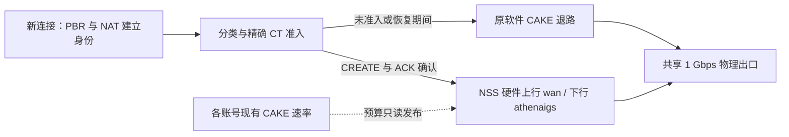

# WAN6：NSS 六账号候选与部署核验

本轮仓库是 `ZyPulse-zy/athena-nss-mainline`，分支 `codex/dorm-qos-v2`，远端起点 `8b44396`，PR #1 保持 draft。路由器实际安装仍为 `2996d40`。**候选未安装，第六账号未认证；没有 WAN6 真实 NSS CREATE 或字节进展。**

## NSS 路径及软件队列的用途

本次扩展的是物理出口上行 `wan` 的 NSS `nsshtb/nssfq_codel` 与下行 `athenaigs` 的 NSS 队列。第六账号拥有 BE/RT 双向标签：上行 `7e65/7e66`、下行 `7a65/7a66`。内核 gate 接受第六 WAN，并在状态中明确声明 `wan_max=6`；writer 拒绝没有此声明的旧模块。精确 CT 身份、完整 mark、zone、NAT 双向元组、32 槽、六秒租约及 CREATE/REMOVE 回执约束继续保留。

软件 CAKE 是既有五账号架构的退路和预算来源，不是本次声称的硬件加速队列。六账号预算映射在同一物理根内；总账号预算上限 900 Mbps，根为 950 Mbps。600 Mbps 理论总量低于物理速率，但学校交换端口是否另有限速尚未测得，不能据此承诺吞吐量。

## 已完成的离线工作

- 显式五/六账号契约贯穿 core、collector、reader、writer、kernel、双向 queue/tag、预算发布、health、coverage、status、native 事务和恢复。缺省仍为五账号，完整 fwmark 非 WAN 位保留；拒绝对现有物理树做五到六的热扩容。
- 维护的 source classifier 扩展地址发现、学习、软件标签和持久 journal 的第六账号；配置构造器要求原 owner 完整恢复后捕获十二个根，不继承过期 selector。现有分类速率、全局/每 host 准入预算没有扩大。
- 第六账号增量方案使用逻辑接口 `campus6`、设备 `rpwan6/rpifb6`、表 106、规则 906/1006 和 mark `0x00060000/0x00ff0000`。原 `network.wan6` 是物理 WAN 的 DHCPv6 接口，必须保留。
- 认证、单实例 DHCP/autorate、watchdog、MAC map、PBR 开机恢复和软件退路维护候选已补齐；普通 300 桶、sticky 和主路由仍只分配 WAN1–5。第六认证只准备第六 MAC，不遍历现有五路；只读确认现网五路 MACVLAN 均为 NSS owner 的 private 模式，新验证器只有在原 native owner/boot/基线 MAC 及 core-guard 许可匹配时接受该模式，不改为 bridge。平台脚本仅通过离线/语法检查，未在路由器执行。
- 第六认证沿用私有配置文件；新账号文件要求 root:root、0600、非链接，凭据不进入 argv。第六认证进程输出关闭，避免诊断泄露账号；现有五账号配置和输出流程保持。本轮没有使用校园网凭据认证或把凭据保存至仓库/证据。

## 测试与只读事实

五账号与六账号各完成 13 Lua + 2 C 维护回归；51 Lua 和 12 shell 文件语法通过。六账号 writer 742 检查，WAN6/完整 mark/共享预算/游戏门控模型的检查数以结构化证据为准；源观察器 63 检查、六账号过期恢复 9 个场景。固件消息和内核 I/O 在模型中是替身。

通过 SSH stdin 在目标 Lua 与原 `luci.jsonc` 上运行四套虚拟文件模型，未安装文件、执行生产 writer 或写入 tc/nft/ECM。目标 `nft -c` 接受增量 PBR/NAT、游戏规则和无 hook 的六账号全身份标签模型；这些只是解析/事务检查，规则没有应用。

找回原 Windows `Athena-Cake-Build` 的 prepared 6.18.44 kernel 和交叉工具链，Windows 分区只读挂载。原 WSL 链接从原 SDK 归档恢复到本地工作副本。新 gate/receipts 模块交叉构建通过；prepared kernel 三个关键输入哈希未变；ECM 和 ingress 回执副本的原代码段未变。输入 ECM、NSS driver、act_nssmirred 三个指纹与实际安装模块一致。**二进制未加载；构建通过不证明六账号 firmware 运行。**

最新只读核验：五个账号均在线；20 个安装维护文件精确匹配 `2996d40`；五个保护文件、认证/分类器/autorate/代理/Tailscale 等所核验服务 PID 和运行态、十个软件根的句柄及固定选项均保持。NSS 为 native-running、sourceFresh，pending/未确认均 0；实时 live 数以证据样本为准。第六认证配置、校园接口和设备均不存在。表 106 及规则 906/1006 可用，WAN 防火墙区名称已确认。旧私有备份的 gzip 完整性和 SHA 已核验，但它不是这次 WAN6 的新检查点。

## 游戏策略：仍禁用

仅候选 IPv4 LAN 第一包、未有 WAN affinity、低于等于 256 字节的 UDP，目的端口窄范围 27015–27050；排除 UDP443/QUIC、DNS、已知 VPN/控制端口、proxy mark、私有/特殊/fake-IP/Tailscale 网段和经审阅的校内/代理/VPN 端点。已有 NAT 连接不改 WAN，未命中仍走原 WAN1–5 和既有 NSS RT 分类。此路由命中本身不授予 RT。

健康循环只有在六账号认证可用、健康、同 boot、native 运行、预算/来源新鲜和双向标签完整时更新 15 秒资格租约；失败/过期不再选择新流。200 个刻意构造样本中 TP 80、FN 20、FP 10、TN 90，这不是现实误识别率。使用相同游戏端口的小包 VPN/普通业务不可仅凭首包识别，必须补全已知端点排除。真实校内公共地址和业务清单未完整核验，故不启用，不能把模拟中的语义标签当作 nft 可识别信息。

## 待批准的受控部署步骤

1. 重新读取远端和现网身份、校验保护文件/模块/五账号状态。创建新的 root-only 私有检查点：原 controller 全套源与二进制/build pins、原 source generation/config/pointer、MAC map、会修改的 init/script/policy、network/firewall 配置及新对象“原先不存在”的记录。五账号认证文件无需复制或修改。记录已拥有对象及 before/after 哈希，不以旧备份替代新检查点。
2. 准备独立于 SSH 控制连接的回退进程，绑定 boot、检查点、目标文件哈希和总截止时间；先确认它存活、入口可运行及完整恢复所需文件可用。**现阶段只是回退步骤/模型，整个 WAN6 平台的独立回退执行器尚未在目标验证；没有此证明就不切换。**
3. 仅建立新 MAC/VLAN 设备、campus6 动态 DHCP、表 106、增量 NAT/forward，沿用私有认证提供流程创建第六账号文件，单独添加第六认证/autorate 实例。原五账号认证、MAC、PBR/NAT、代理/Tailscale、无线不重建；只对会改动的文件做所有权和哈希检查。持久 network/firewall 仅追加新接口/区成员，不做全局网络或防火墙 reload。新 MAC 必须现场确认未用，不能照抄模型值。
4. 一次完整 native stop → 精确 firmware 撤销/原物理队列恢复确认 → 原 source stop/owned 恢复 → 核验旧 worker/guardian 已退出及 owned 清理完成，将旧 RAM owner/journal 按 inode 与 owner 原子转入同 tmpfs 私有检查点，再捕获十二软件根并构造新 source config（不原地改 journal 的 WAN 数） → 单 writer 成套安装/start。旧 init 的全局 shaper teardown 不可调用；必要的 watcher 切换只针对指定 procd 实例，保持五账号根。新 profile/source/build/module 成套绑定，不混装，也不热迁移既有 NAT。
5. 检查六账号来源、十二预算和共享 NSS 双向树。对明确授权的一条新 LAN 连接或自然命中的新流核验 WAN6 的完整 CT/mark/NAT、CREATE 与 REMOVE 回执、两方向 QoS 标签以及同代逐流字节增长；没有真实流或没有回执就记“未验证”。仅有 router 自身健康 ping 不足以证明 LAN WAN6 NSS。不开拥塞/故障测试，也不据模型或全局字节数替代逐流证据。
6. 先不启用游戏广泛分流；排除清单和首包风险通过审阅后才单独开启窄策略。失败立即按下方路径回退，不重复试装。

共享 NSS/source 成套切换会短暂撤销硬件连接，使现有连接经过软件退路，可能增加延迟或短暂断流。是否允许建立新检查点和独立回退，并在全部前提验证通过后进行这一次受控切换，需用户额外明确确认。不重启整台路由器、不刷固件、不换 EDMA。

## 完整回退顺序

- 先撤回 WAN6 新流资格和已记账的专属 hook，保留五账号 buckets/sticky 与完整 mark。
- 经原独立 native guardian 停止 candidate；等精确 REMOVE/firmware absent、原物理根和 core guard 恢复证明。存在未确认时停止推进，不强卸模块。
- 用 candidate 的 generation/hash 停止并恢复其十二根 owned selector/journal。确认无 owned 残留并按相同所有权规则退休 candidate RAM owner 后，换回原 RAM 检查点和 source 指针/config；不能用旧十根 config 去清理第六根新 owner。
- 仅停止第六认证/autorate、down campus6、删除记录的第六 DHCP 路由。表 106 必须留下不可达 default，规则 1006 保留，直到两个完整、新鲜、无截断的 CT 读均确认没有第六 WAN mark；否则删除规则会让残留连接落入主路由并产生隐式迁移。
- 按 journal 候选哈希匹配后恢复检查点的变动文件、MAC map、原 source 指针和 init/script；恢复新文件原先不存在的状态，仅删除新 owned 设备和 nft 对象。保留原 DHCPv6 wan6。遇并发/未知变动拒绝覆盖并保留诊断。
- 用原 build pins 启动原五账号 source/native，恢复必要 watcher 实例，不调用全局软件队列 teardown。逐项核验五账号、保护文件、服务、十根固定选项、sourceFresh、真实回执与 NSS。最后在 CT fence 条件满足后移除新增不可达路由/mark rule。

回退方案可审阅，native 现有 guardian 生命周期继续复用；本轮没有把新平台回退模型当成已执行或已验证的完整回退。部署和真实六账号验收仍等待批准及这些前提。
