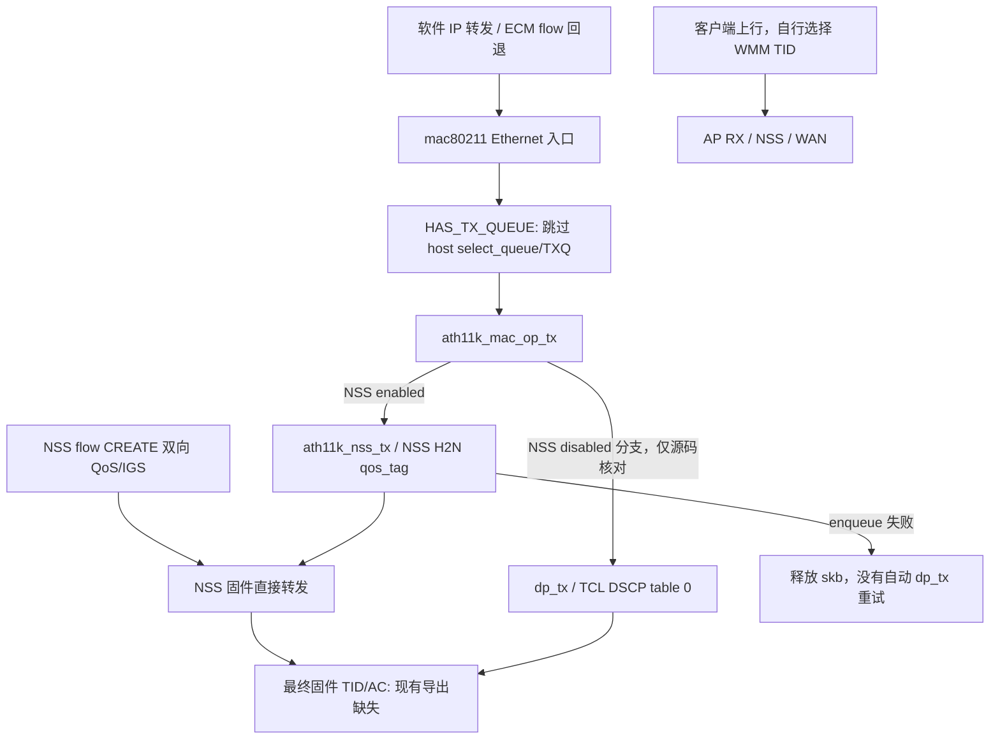

# 部署后被动稳定性、TID/AC 与 AQL

本轮只读观察，没有重载无线、装载模块、重启服务、主动造流、调整参数或启用扩展统计。正式游戏验收继续延期。当前 ath11k 为003已部署版本，mac80211为001/002阶段版本，NSS保持原模块；精确哈希与源码文件哈希/行号见[匿名证据](../evidence/dorm-v2-wifi-passive-stability.json)。以维护代码和实际安装文件为依据，没有使用旧Windows三槽方案。

## 被动稳定性结果

三个独立30秒 native窗口共33个时间样本，sourceGaps/新增恢复/计数重置均0，末态均native-running；NSS实际数量1–6。共有51个RT CREATE已确认的流样本、55个RT字节进展流样本、99个双向标签核验流样本，标签不匹配0。这些是可重复出现的流样本，不是51条新连接，更不是空口TID读回。

第二个窗口观察到一个无线BULK候选；它虽预算准入，但没有CREATE ACK、policyApplied或硬件归属字节，标签状态not-created。没有将它冒充BULK NSS发送成功，也没有用全局NSS增长分摊到该流。另做25秒、六次同MAC分组观察，12次本地文件读取共约0.06秒：均sourceFresh，只有RT，没有RT/BULK同时存在的设备。身份只在私有目录/进程内使用，提交仅包含数量。

两个独立无线窗口各30秒、84次有界查询，总查询成本约1.01/0.98秒，单次最大0.11/0.10秒。三个AP、CN、149/80MHz、36/80MHz、2.4GHz 6/20MHz保持。前后boot、保护配置、维护执行文件、模块哈希、软件队列合同、全部核验服务PID/start一致，六账号在线。原始MAC、终端身份、日志和私有目录名不提交。

本窗可关联下行字节约3.16/2.92MB、上行约0.42/0.22MB主要在149射频；36射频没有关联终端，但主频survey busy约5.42%/14.84%；149约4.21%/5.57%。统计仅覆盖被观察的稳定关联，不覆盖所有桥转发或整个80MHz频块。busy不是外部干扰率，也不能凭没有终端便判断该频谱空闲。短窗不构成长期负载均衡依据，保留当前两个不同80MHz频块。

## 精确路径与分类边界



| 路径/证据层 | 已确认 | 尚不能确认 |
|---|---|---|
| 分类/准入 | writer对合格RT低位6、BE/BULK低位0，叠加完整高位硬件队列tag；精确nft只写meta priority，没有统一改DSCP | 低位6并非256..263的强制UP魔数，高位tag不是无线AC |
| 软件IP转发或ECM flow回退 | 当前三PHY均HAS_TX_QUEUE/NSS/TID_CLASS/TX_ENCAP；Ethernet入口跳过host select_queue，driver NSS enabled走nss_tx | 不能称flow回退恢复host TXQ/AQL，不能假设软件分类表被调用 |
| 主机NSS入口 | NSS descriptor保留完整32-bit skb priority为qos_tag，多H2N环按完整priority非零选优先环 | RT与带高位tag的BULK都可非零；该CPU/H2N环不是最终WMM AC |
| NSS加速 | 自然RT有CREATE ACK/标签/同代字节进展；固件版本指纹已核实 | 末端DSCP map、HLOS TID override及覆盖优先顺序没有现场读回；BULK无本窗CREATE实证 |
| 真正NSS disabled普通dp_tx | 源码选择TCL DSCP table0；默认表DSCP>>3，descriptor不设置TID_OVERWRITE/PACKET_TID | 本轮没有切换该分支；不能当作现场NSS最终表 |
| 硬件TID分类标志 | 驱动设置并现场宣告SUPPORTS_TID_CLASS_OFFLOAD | 本树该标志只有定义、设置、debugfs展示，标志本身不证明固件当前分类规则 |
| 无线下行 | 已有NSS peer字节/MPDU retry统计更新，003布局及消费者已核实 | 无最终TX TID/AC导出，不把CREATE正确等同于下行最终队列正确 |
| 客户端上行 | AP读到聚合RX计数/信号/速率；客户端决定上行QoS TID | WAN方向RT tag不能反向控制客户端之前的空口争用，无客户端TX/空口TID联证 |

标准UP/TID0/3→BE、1/2→BK、4/5→VI、6/7→VO，mac80211与NSS头的映射一致；不意味着所有路径选择相同UP/TID。23项实际源码函数/表模型通过：无QoS map/VLAN覆盖时，软件RFC8325分类EF46→UP6/VO，而TCL表EF46→TID5/VI；普通priority6或含高位tag的priority在DSCP0时并不强制UP6，magic262才强制UP6；QoS map/VLAN另可覆盖。模型是主机离线分支测试，没有模拟成功的固件发送。

`nss_wifi_vdev.h`定义DSCP map/DSCP override/HLOS TID override命令，但精确ath11k nss.c无对应调用。固件C实现不在发行包中，默认值及覆盖顺序没有权威源码/现场读回。不能用其他分支补丁证明现场启用，也不据此修改标签。

## AQL：当前host约束不生效，不等于没有固件队列控制

现场三个PHY的aql_enable=1，低/高限额5000/12000us，四AC pending均0；nl80211查询成功但未宣告EXT_FEATURE_AQL。host AQM只有表头，station airtime累计为0，deficit四AC均256；driver_buffered_tids为0。

精确源码链有两层独立原因：

1. ath11k无AQL feature设置；`ieee80211_txq_airtime_check`在未宣告能力时直接返回true，pending记账函数也直接返回，不进行限制。离线模型验证：即使pending超限，feature缺失仍放行；feature存在时才按低/高门限限制。
2. `HAS_TX_QUEUE`跳过host TXQ建立/排队，station TXQ不建立。这个标志在该ath11k源码中无条件设置，不能假设仅关闭NSS就会恢复host AQL。

因此当前正常软件→NSS无线入口和固件加速路径没有经过有效mac80211 AQL限制。pending=0是host记账值，不能证明无线积压为0；aql_enable=1只代表未全局禁用，不代表driver能力或路径成立。`driver_buffered_tids`是驱动报告的缓存位图，并非已发送TID直方图。

NSS/无线固件自身是否另有队列深度、调度、流控及具体门限仍未知，本轮没有为取得统计而开启扩展HTT或改变接口模式。不能将“host AQL不生效”扩大成“空口没有任何限制”。

## 统计口径与可执行命令

现场nss_peer_stats_config原本均1，本轮只读，没有提升统计开关。现有nss_stats返回每peer汇总，含MPDU retry等，**没有逐TID/AC字段**。station tidState明确not-exported；host station aql/tx_retry_count/tx_retry_failed文件缺失记为missing，而非零。真实读到的零、缺失、空表、失败、关联变化及计数重置分别保留。MPDU重试不能除以MSDU tx_packets，NSS TQM drop也不能等同重试耗尽；本轮不生成这类跨口径比例。

```sh
# 路由器，独立手动入口，无新增常驻采集
/usr/lib/athena-dorm-native/athena-qos diagnose 30
/usr/lib/athena-dorm-native/athena-qos wifi-diagnose 30
# Linux仓库，仅离线源码模型
python3 tools/test_wifi_tid_aql.py --backports ../linux-wifi-build/build-firmware-212-cn-02/backports
```

## 保留配置、候选与具体缺口

保留六WAN/游戏WAN6策略、认证/PBR/NAT、代理/Tailscale、CAKE/autorate、WMM、信道/频宽/功率、聚合、省电。没有可靠依据给全部RT升VO、给所有UDP提权、按连接人数均衡或改AQL阈值；未发现本轮应立即修复的新软件缺陷。

最有价值的后续工作是补充最终发送证据：同一关联终端同时具有自然RT与BULK，按精确流身份/代次联结软件分类、NSS CREATE/真实字节、最终TX完成的TID/AC及队列深度；上行需要客户端TX或独立空口证据。现有fw/driver导出缺少最终字段，内核未开启kprobe/ftrace，不能在当前只读边界内补齐这段。另需固件DSCP/TID override有效值/顺序及固件队列流控权威定义。新增逐包追踪或额外统计可能增加成本，应另行评估，当前未启用。

只有这些数据证实映射不一致，才值得做局部映射修复；可能收益是同机RT/BULK空口服务一致，代价是影响无线争用及NSS ABI/控制交互。改AQL低/高值在当前旁路上没有有效控制收益，关闭NSS或替换队列模式影响加速与吞吐，本轮不执行。长期高峰、冷启动、最终空口与正式游戏验收仍未完成；这轮几分钟被动观察不能代替长期稳定性承诺。

补充RX/TX源码与只读前置：`dp_rx.c`的普通REO接收描述符读出rxcb->tid，NSS异常接收重建也从MPDU-start读取tid；PPDU ACK/BA状态可包含TX TID。这个临时字段没有逐流最终TID导出，per-peer统计只用tid区分QoS/非QoS并累加汇总。现有ext_tx_stats/ext_rx_stats六个读取值均为0；补充快照的一个关联站tx_stats/rx_stats两个文件均缺失（自然关联数量随窗口变化）；不写开关、不读会主动请求HTT的htt_peer_stats文件。普通RX/异常接收源码存在，不等于所有NSS fastpath上行均经过该处理函数。最终上行/下行联证仍缺，已明确定位到具体字段及导出缺口。
